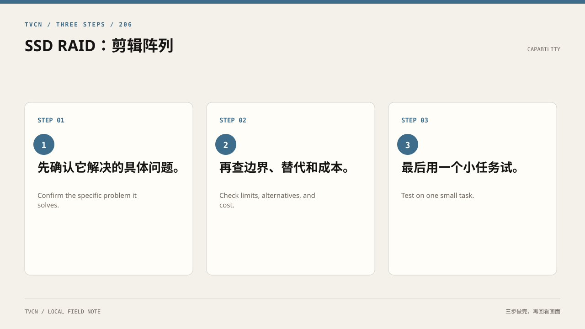

SSD RAID 是剪辑工作盘，不是归档；阵列一坏，重建比备份更贵。

<!-- DIAGRAM_START -->
<h2>图解</h2>
<figure>
  
  <figcaption>把三步按顺序做完，再回看画面或文件。</figcaption>
</figure>
<!-- DIAGRAM_END -->
<h2>现场</h2>

建 RAID 0 只放工作素材，另设 RAID 1 或 NAS 做备份；跑满盘测试，看降速。

<h2>怎么做</h2>

SSD RAID 是剪辑工作盘，不是归档；阵列一坏，重建比备份更贵。
<ol><li>建 RAID 0 只放工作素材。</li><li>另设 RAID 1 或 NAS 做备份。</li><li>跑满盘测试，看降速。</li></ol>
<h2>别踩</h2>

别把 RAID 0 当唯一存储；一块盘坏，全部素材一起没。

<h2>验收</h2>
<ul><li>RAID 0 只存工作素材，原始素材另有备份。</li><li>RAID 1 或 NAS 的备份任务在运行。</li><li>满盘测试记录了写入降速幅度。</li></ul>
