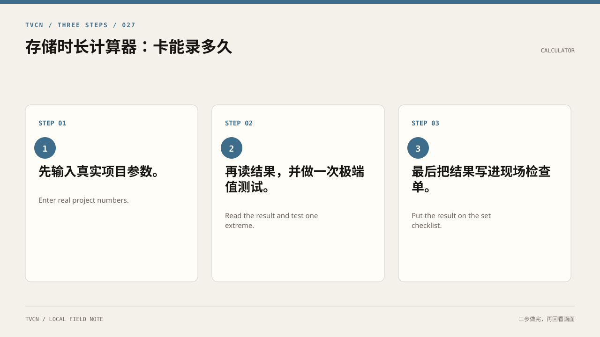

可录时长（分钟）≈ 容量（GB）× 8 × 1000 ÷ 码率（Mbps）÷ 60 。这是按十进制 GB 算的上限，实际要留 10%–15% 给格式化、音频和末尾文件。

<!-- DIAGRAM_START -->
<h2>图解</h2>
<figure>
  
  <figcaption>看“4K 100 Mbps 约 45 G…”和“再加两份备份，总量乘三”两处，判断这个参数能不能对应到一个具体的拍摄问题。</figcaption>
</figure>
<!-- DIAGRAM_END -->
<section><h2 id="section-1">公式</h2>
可录时长（分钟）≈ <strong>容量（GB）× 8 × 1000 ÷ 码率（Mbps）÷ 60</strong>。这是按十进制 GB 算的上限，实际要留 10%–15% 给格式化、音频和末尾文件。

例子：128 GB 卡、200 Mbps：128 × 8 × 1000 ÷ 200 ÷ 60 ≈ 85 分钟。按 80% 安全线，只规划 68 分钟。
<h2 id="section-2">现场表</h2><ul><li>100 Mbps：128 GB ≈ 170 分钟；256 GB ≈ 341 分钟。</li><li>200 Mbps：128 GB ≈ 85 分钟；256 GB ≈ 170 分钟。</li><li>400 Mbps：128 GB ≈ 42 分钟；256 GB ≈ 85 分钟。</li></ul><h2 id="section-3">边界</h2>
卡的实际可用容量、文件系统和相机缓存都会影响结果；长时间录制还要看过热和卡速，不要用“能录多久”替代现场测试。
</section><section><h2 id="section-4">现场</h2>
4K 100 Mbps 约 45 GB 一小时；再加两份备份，卡至少留 20% 余量。
</section><section><h2 id="section-5">怎么做</h2><ol><li>4K 100 Mbps 约 45 GB 一小时。</li><li>再加两份备份，总量乘三。</li><li>卡至少留 20% 余量。</li></ol></section><section><h2 id="section-6">别踩</h2>
别信相机剩余时间；它按当前码率估，换格式就全错。
</section><section class="calc-widget" data-calculator="storage-calculator">
<h2 id="section-7">存储计算器</h2>

按十进制 GB（1GB=8000 Mb）估算；实际格式化容量和录制开销会更少。

<label class="calc-field">卡容量（GB）<input type="number" inputmode="decimal" data-calc="capacity" data-default="128" value="128" step="1" min="1"></label><label class="calc-field">录制码率（Mbps）<input type="number" inputmode="decimal" data-calc="bitrate" data-default="200" value="200" step="1" min="1"></label><label class="calc-field">预留安全空间（%）<input type="number" inputmode="decimal" data-calc="safety" data-default="10" value="10" step="1" min="0"></label>

<strong data-out="result">可录 —</strong>长时间录制还要考虑电池、分段和卡速。

<button type="button" data-reset>恢复默认</button>

公式：分钟 = 容量GB × 8000 ÷ 码率Mbps ÷ 60 × (1 − 安全比例)。

<noscript>
JavaScript 关闭时按公式手算；128GB、200Mbps、留 10% 约 76 分钟。
</noscript>
</section><section><h2>替代</h2>
如果“4K 100 Mbps 约 45 G…”不是你的主问题，先用“再加两份备份，总量乘三”对应的基础做法；两项都成立再考虑升级。
</section><section><h2>60 秒自测</h2>
用现有器材按“4K 100 Mbps 约 45 G…”做一次 60 秒测试，记下一个数字；数字没有变化，就不要加预算。
</section>
<h2>验收</h2><ul><li>码率、时长、备份份数三项都填了真实值。</li><li>算出的总量包含三份拷贝和 20% 余量。</li><li>结果写进现场检查单，不靠相机剩余时间。</li></ul>
