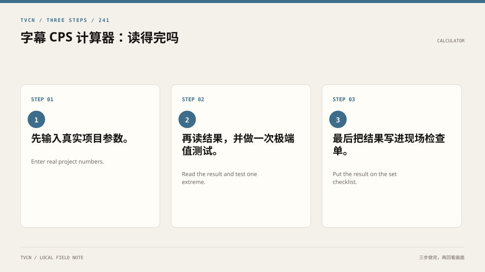

字幕 CPS 计算器看每秒字符数；超过阅读速度，观众会暂停，片子就断了。

<!-- DIAGRAM_START -->
<h2>图解</h2>
<figure>
  
  <figcaption>把三步按顺序做完，再回看画面或文件。</figcaption>
</figure>
<!-- DIAGRAM_END -->
<h2>现场</h2>

中文每秒不超过 9 字，英文不超过 15 字符；超出就拆句或延长停留。

<h2>怎么做</h2>

字幕 CPS 计算器看每秒字符数；超过阅读速度，观众会暂停，片子就断了。
<ol><li>中文每秒不超过 9 字，英文不超过 15 字符。</li><li>超出就拆句。</li><li>或延长停留时间，不要压成两行小字。</li></ol>
<h2>别踩</h2>

别靠缩小字号塞字；观众读不完，只会暂停或放弃。

<h2>验收</h2>
<ul><li>每条字幕的 CPS 在中文 9 字、英文 15 字符以内。</li><li>超标条目已拆句或延长，不是缩字号。</li><li>按成片速度播放，能一次读完不暂停。</li></ul>
