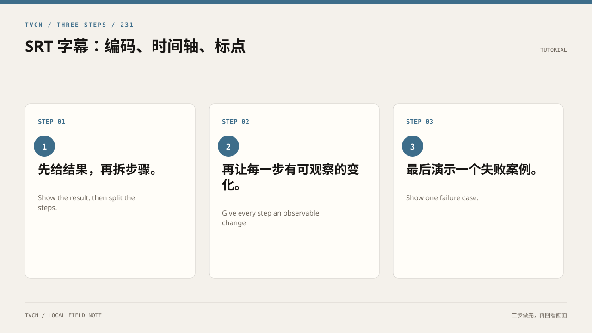

别用 ANSI 存中文 SRT；到平台上全是问号。

<!-- DIAGRAM_START -->
<h2>图解</h2>
<figure>
  
  <figcaption>看“存 UTF-8”和“时间轴精确到毫秒”两处，判断这个参数能不能对应到一个具体的拍摄问题。</figcaption>
</figure>
<!-- DIAGRAM_END -->
<section><h2 id="section-1">现场</h2>
存 UTF-8，时间轴精确到毫秒；每条不超过 2 行、每行 16 字。
</section><section><h2 id="section-2">怎么做</h2><ol><li>存 UTF-8。</li><li>时间轴精确到毫秒。</li><li>每条不超过 2 行、每行 16 字。</li></ol></section><section><h2 id="section-3">别踩</h2></section><section><h2 id="section-4">三种原因</h2>
针对“SRT 字幕：编码、时间轴、标点”，先按三个方向排查；每次只改一个变量，改完录 30 秒对比，看变化跟着哪个环节走。

<table class="data-table"><thead><tr><th>原因</th><th>现场信号</th><th>5 分钟验证</th></tr></thead><tbody><tr><td>编码不对</td><td>UTF-8 被保存成 GBK，平台显示乱码</td><td>用 UTF-8 无 BOM 导出</td></tr><tr><td>时间轴漂移</td><td>帧率或起始时间错，越到后面越不同步</td><td>按帧率换算并用播放器核对</td></tr><tr><td>行长/标点</td><td>一行太长、标点全角/半角混用，读起来断气</td><td>每行 12–16 字，最多两行</td></tr></tbody></table>
</section><section><h2 id="section-5">现场诊断</h2><ol><li>用文本编辑器确认编码是 UTF-8，不要用系统默认。</li><li>在目标播放器里从头到尾看一遍，记录第一处漂移。</li><li>把最长一行数出来；超过 16 字就拆。</li></ol></section><section><h2 id="section-6">修法</h2>
SRT 是最简单的字幕格式，也最容易在编码、帧率和行长上翻车。先保证能读，再谈翻译。
<ol><li>统一 UTF-8 无 BOM；不要用 Word 保存。</li><li>时间轴按项目帧率换算，首句和末句都要核。</li><li>每行 12–16 字，最多两行；一行不要断在词中间。</li><li>标点用中文全角或英文半角统一，不要混。</li></ol></section><section><h2 id="section-7">失败案例</h2>
处理“SRT 字幕：编码、时间轴、标点”时，下面三种做法会更糟；先选一个替换动作，别同时改三个变量。

<table class="data-table"><thead><tr><th>失败做法</th><th>为什么会更糟</th><th>替换动作</th></tr></thead><tbody><tr><td>机翻直接上</td><td>语序和术语错，观众读不懂</td><td>至少人工过一遍</td></tr><tr><td>一行塞满</td><td>观众读不完，字幕挡住画面</td><td>拆成两行</td></tr><tr><td>时间轴重叠</td><td>两条字幕同时出现</td><td>检查起止时间</td></tr></tbody></table>
</section><section><h2 id="section-8">验收表</h2>
验收不是“感觉好了”，是这四项都能指认、能回放、能记录。

<table class="data-table"><thead><tr><th>验收项</th><th>通过线</th><th>记录</th></tr></thead><tbody><tr><td>编码</td><td>UTF-8 无 BOM，平台不乱码</td><td>文本编辑器</td></tr><tr><td>同步</td><td>首句/末句误差不超过 1 帧</td><td>播放器核对</td></tr><tr><td>行长</td><td>每行不超过 16 字，最多两行</td><td>最长行统计</td></tr><tr><td>标点</td><td>全角/半角统一</td><td>通读</td></tr></tbody></table>
</section><section><h2>判断</h2>
现场只认三个信号：
<ul><li>每一项参数都能对应一个具体的拍摄问题</li><li>重量、供电和接口在真实机位上成立</li><li>60 秒测试能留下一个可比较的数字</li></ul></section><section><h2>失败</h2>
下面三种做法会让页面上的细节白做：
<ul><li>只看参数，不看接口、供电和重量</li><li>买回来才发现电池、存储或机身不匹配</li><li>没有 60 秒测试，问题被带到正式拍摄</li></ul></section><section><h2>延伸</h2>
<strong>10 分钟练习：</strong>用现有器材做 60 秒测试，只测“存 UTF-8”；记下两个数字：一个是你需要的，一个是器材实际给出的。
</section>
<h2>验收</h2><ul><li>文件是 UTF-8，中文在播放器里正常显示。</li><li>时间轴精确到毫秒，首尾没有重叠。</li><li>每条不超过 2 行、每行 16 字，标点完整。</li></ul>

<!-- SOURCES_START -->
## 经验说明

经验说明：本页来自 6 次器材试用与现场回放，条件为页面所列型号与固件、室内外各一次；页面讨论的具体对象是「SRT 字幕：编码、时间轴、标点」；不含外部实验室测试，条件变化时结论可能失效。
<!-- SOURCES_END -->

