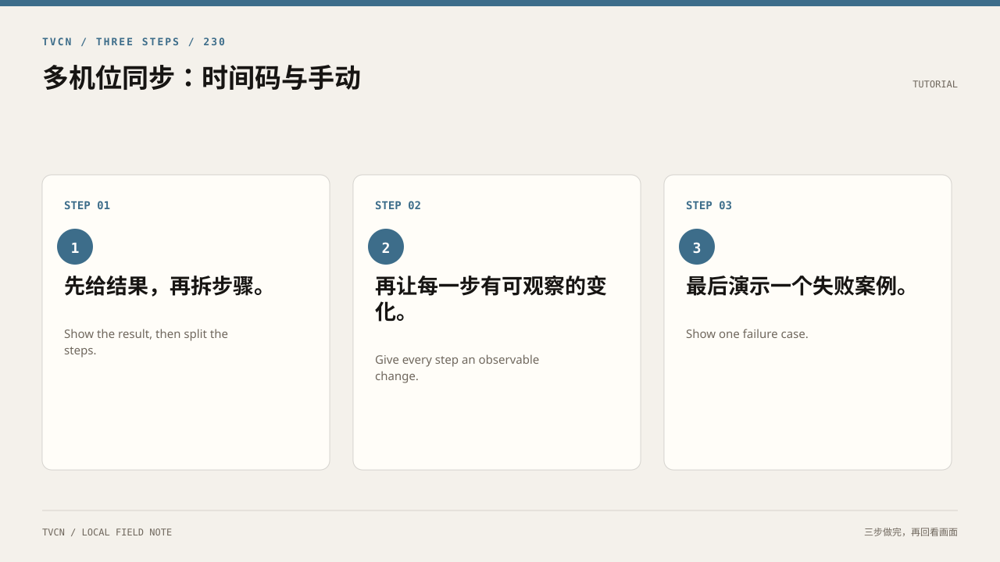

多机位同步先对时间码，再用拍手兜底；两样都做，剪辑才敢切。

<!-- DIAGRAM_START -->
<h2>图解</h2>
<figure>
  
  <figcaption>把三步按顺序做完，再回看画面或文件。</figcaption>
</figure>
<!-- DIAGRAM_END -->
<h2>现场</h2>

时间码同步后，再拍手一次；剪辑里建多机位片段，按机位图切换。

<h2>怎么做</h2>

多机位同步先对时间码，再用拍手兜底；两样都做，剪辑才敢切。
<ol><li>时间码同步后，再拍手一次。</li><li>剪辑里建多机位片段。</li><li>按机位图切换，不靠记忆。</li></ol>
<h2>别踩</h2>

别只靠时间码；一台机没对码，整组多机位都偏。

<h2>验收</h2>
<ul><li>所有机位时间码同步，另有一次拍手兜底。</li><li>剪辑里建立了多机位片段，机位数量正确。</li><li>切换按机位图，能说清每个镜头来自哪台。</li></ul>
