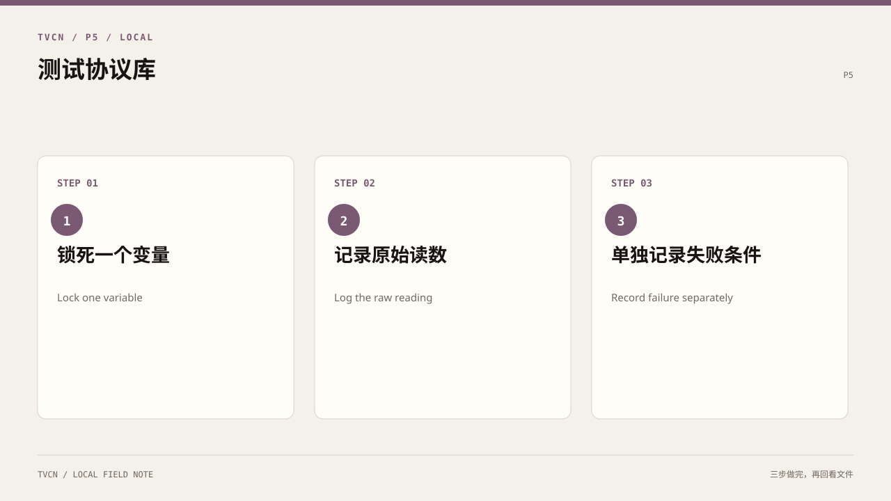

先别记结论：测试协议库：十项现场可复现测试 这一页只回答一个现场问题——条件成立时怎么做，条件不成立时在哪一步停下。读完后拿自己的素材复述一次，能复述才算读懂。

<!-- DIAGRAM_START -->
<h2>图解</h2>
<figure>
  
  <figcaption>十项测试的记录结构：条件、读数、失败。</figcaption>
</figure>
<!-- DIAGRAM_END -->
<h2>使用说明：没有实测就写“未实测”</h2>

这 10 个协议是给有器材的人照做的，不是实验室成绩单。每条记录机器、固件、镜头、软件版本、环境、方法、原始数据、失败条件和成本。没有器材就只写公开规格和步骤，不补数字；页面出现“未实测”不是缺点，是边界。
<ol><li>一次只改一个变量；其他条件锁死。</li><li>先拍基准，再加变量；每个条件至少 2 条。</li><li>记录失败，不只记录成功。</li><li>原始文件不覆盖，命名带日期和条件。</li></ol>
<h2>原始数据表：一行一次测试</h2>

下载 CSV 模板，按行记录。字段：日期、测试编号、机器/固件、镜头、软件版本、室温、方法、变量、原始读数、通过/失败、失败条件、文件路径。没有读数的行留空，不要填“正常”。

<a href="../../assets/test-protocol-template.csv">下载测试记录模板（CSV）</a>

<h2>01 滚动快门/果冻</h2>

<strong>目的：</strong>快速横摇时直线是否变成斜线；读速与快门的关系。

<table class="data-table"><thead><tr><th>方法</th><th>原始记录</th><th>通过线</th></tr></thead><tbody><tr><td>架三脚架，24mm 广角，快速左右摇 2 秒；分别用 1/50、1/100、1/200 拍同一面直线。</td><td>横摇角度、快门、镜头、固件；回放记录直线弯曲像素。</td><td>1/50 下直线可接受，不变成斜塔。</td></tr></tbody></table>

已知失败：只看参数表，不做横摇。 本页记录方法，不写未实测的数据。

<h2>02 低照度噪点与双原生 ISO</h2>

<strong>目的：</strong>暗部噪点、双原生 ISO 切换点、肤色是否可用。

<table class="data-table"><thead><tr><th>方法</th><th>原始记录</th><th>通过线</th></tr></thead><tbody><tr><td>固定光圈/快门，ISO 从原生到 3200 逐档拍同一张灰卡和人物；关掉降噪。</td><td>ISO、双原生档位、温度、降噪设置；记录暗部色块。</td><td>ISO 3200 肤色可辨，暗部无明显色块。</td></tr></tbody></table>

已知失败：只在屏幕上放大看，不记录 ISO。 本页记录方法，不写未实测的数据。

<h2>03 自动对焦呼吸与追焦</h2>

<strong>目的：</strong>人眼/物体切换是否拉风箱，暗光是否可用。

<table class="data-table"><thead><tr><th>方法</th><th>原始记录</th><th>通过线</th></tr></thead><tbody><tr><td>让一个人从 1 米走到 3 米，再走出画面；暗光/逆光各一次。</td><td>镜头、固件、对焦模式、光源；记录失焦次数和恢复时间。</td><td>切换不拉风箱，暗光能追上。</td></tr></tbody></table>

已知失败：只拍静态物体，不测移动。 本页记录方法，不写未实测的数据。

<h2>04 镜头呼吸与齐焦</h2>

<strong>目的：</strong>变焦时焦点是否漂移，画面是否缩放。

<table class="data-table"><thead><tr><th>方法</th><th>原始记录</th><th>通过线</th></tr></thead><tbody><tr><td>固定机位，对同一张图表从广角端推到长焦端；再反向。</td><td>焦段、光圈、最近对焦距离；记录呼吸位移。</td><td>推拉后焦点仍可接受，不出现明显缩放。</td></tr></tbody></table>

已知失败：只看单帧，不推拉。 本页记录方法，不写未实测的数据。

<h2>05 录音前级底噪与增益</h2>

<strong>目的：</strong>录音机/麦克风前级底噪和增益结构。

<table class="data-table"><thead><tr><th>方法</th><th>原始记录</th><th>通过线</th></tr></thead><tbody><tr><td>安静房间录 30 秒 room tone；正常说话、近距喊话各一次。</td><td>增益、麦克风、采样率、温度；记录底噪和削波。</td><td>正常说话峰值 -12dBFS，安静段无明显嘶声。</td></tr></tbody></table>

已知失败：只凭耳朵，不 solo 音轨。 本页记录方法，不写未实测的数据。

<h2>06 ND 偏色</h2>

<strong>目的：</strong>ND 是否偏色、暗角、实际档位。

<table class="data-table"><thead><tr><th>方法</th><th>原始记录</th><th>通过线</th></tr></thead><tbody><tr><td>无 ND 与加 ND 各拍白墙/灰卡，保持光圈，调快门；广角端再拍一张。</td><td>ND 品牌、标称档位、镜头焦段；记录 RGB 偏移。</td><td>白墙不偏绿/品红，四角不明显变暗。</td></tr></tbody></table>

已知失败：只看滤镜刻度，不拍白墙。 本页记录方法，不写未实测的数据。

<h2>07 存储卡/SSD 持续写入与发热</h2>

<strong>目的：</strong>持续写入是否掉速、发热、掉盘。

<table class="data-table"><thead><tr><th>方法</th><th>原始记录</th><th>通过线</th></tr></thead><tbody><tr><td>连续写入 30 分钟项目码率 2 倍的素材；记录速度/温度。</td><td>卡型、读卡器、接口、室温；记录最低速度和掉盘。</td><td>30 分钟不低于项目码率 2 倍。</td></tr></tbody></table>

已知失败：只测 10 秒峰值。 本页记录方法，不写未实测的数据。

<h2>08 监视器亮度与延迟</h2>

<strong>目的：</strong>亮度、色彩、延迟是否适合跟焦/调色。

<table class="data-table"><thead><tr><th>方法</th><th>原始记录</th><th>通过线</th></tr></thead><tbody><tr><td>接同一信号源，与电脑屏幕并排；拍手看延迟；遮光罩下看亮度。</td><td>监视器型号、亮度、色域、接口；记录延迟帧数。</td><td>延迟≤1 帧，亮度和色彩可校准。</td></tr></tbody></table>

已知失败：只看参数，不并排。 本页记录方法，不写未实测的数据。

<h2>09 稳定器跟随与回弹</h2>

<strong>目的：</strong>跟随模式是否滞后、回弹、走路是否稳定。

<table class="data-table"><thead><tr><th>方法</th><th>原始记录</th><th>通过线</th></tr></thead><tbody><tr><td>调平后走 10 米直线、绕人半圈、上下楼梯；每个动作拍 3 条。</td><td>稳定器型号、固件、镜头重量；记录回弹和抖动。</td><td>10 米直线无明显回弹，楼梯不撞限位。</td></tr></tbody></table>

已知失败：只在原地转，不走路。 本页记录方法，不写未实测的数据。

<h2>10 导出时间与硬件瓶颈</h2>

<strong>目的：</strong>导出时间、GPU/CPU/磁盘瓶颈、失败条件。

<table class="data-table"><thead><tr><th>方法</th><th>原始记录</th><th>通过线</th></tr></thead><tbody><tr><td>同一条 4K 10-bit 时间线导出 H.264 与 ProRes，记录时间与占用。</td><td>机器、GPU、软件版本、缓存、磁盘；记录失败原因。</td><td>导出可完成，时间可复现；不把一次跑分当结论。</td></tr></tbody></table>

已知失败：只导一次，不记录环境。 本页记录方法，不写未实测的数据。

<!-- P5_EXTRA_START -->
<h2>补：一行记录怎么写</h2>

示例：日期 2026-11-23；测试 RS-01；机器 A7S3 / 固件 2.0；镜头 24mm；软件 NLE 1.0；室温 22°C；方法“2 秒横摇，1/50”；变量“快门 1/100”；原始读数“直线弯曲 18px”；结论“失败”；失败条件“快速横摇”；文件路径“/tests/RS-01.mp4”。没有读数的格子留空，不要写“正常”。

<h2>补：失败条件必须单独写</h2>

失败不是“效果不好”，是一个可复现的条件：哪台机器、哪个固件、哪个镜头、什么温度、什么卡、什么设置。写不清失败条件，测试就不可复现，也不能拿来做购买决策。
<ol><li>先写通过线，再写失败点。</li><li>失败点要能被别人按同样步骤复现。</li><li>失败文件单独保存，不覆盖。</li></ol>

<!-- SOURCES_START -->
## 参考与延伸阅读

- [S23] [SMPTE 标准入口](https://www.smpte.org/standards) — 2026-11-26 访问。用于核对首段“十项测试的可复现步骤、原始记录字段和通过线；没有器材就写“未实测”，不编数字。”中的术语与公开背景（时间码、色彩、影院与信号链标准的机构入口）；不替代现场测试。
- [S25] [ITU-R BT.709](https://www.itu.int/rec/R-REC-BT.709/en) — 2026-11-26 访问。用于核对首段“十项测试的可复现步骤、原始记录字段和通过线；没有器材就写“未实测”，不编数字。”中的术语与公开背景（HD SDR 的色域、传递函数与观看条件）；不替代现场测试。
- [S26] [ITU-R BT.2020](https://www.itu.int/rec/R-REC-BT.2020/en) — 2026-11-26 访问。用于核对首段“十项测试的可复现步骤、原始记录字段和通过线；没有器材就写“未实测”，不编数字。”中的术语与公开背景（UHD/HDR 的宽色域与参数定义）；不替代现场测试。
- [S29] [YouTube 上传规格](https://support.google.com/youtube/answer/1722171) — 2026-11-26 访问。用于核对首段“十项测试的可复现步骤、原始记录字段和通过线；没有器材就写“未实测”，不编数字。”中的术语与公开背景（分辨率、码率、帧率与音频编码建议）；不替代现场测试。
- [S30] [DaVinci Resolve 产品与文档](https://www.blackmagicdesign.com/products/davinciresolve) — 2026-11-26 访问。用于核对首段“十项测试的可复现步骤、原始记录字段和通过线；没有器材就写“未实测”，不编数字。”中的术语与公开背景（剪辑、调色、Fusion 与交付的官方产品入口）；不替代现场测试。
<!-- SOURCES_END -->

