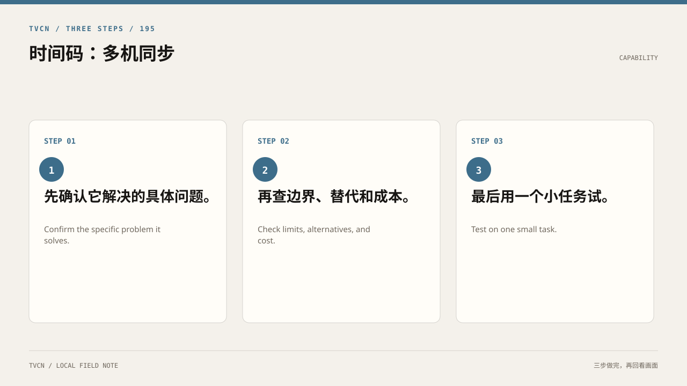

时间码让多机位和录音机在后期的第一分钟就对上；没有它，合板要靠运气。

<!-- DIAGRAM_START -->
<h2>图解</h2>
<figure>
  
  <figcaption>把三步按顺序做完，再回看画面或文件。</figcaption>
</figure>
<!-- DIAGRAM_END -->
<h2>现场</h2>

让录音机和摄影机对同一个时间码，拍 10 秒；后期合板看偏差是否小于 1 帧。

<h2>怎么做</h2>

时间码让多机位和录音机在后期的第一分钟就对上；没有它，合板要靠运气。
<ol><li>让录音机和摄影机对同一个时间码。</li><li>拍 10 秒测试。</li><li>后期合板，看偏差是否小于 1 帧。</li></ol>
<h2>别踩</h2>

别只对一次时间码就拍一整天；漂移会在下午出现。

<h2>验收</h2>
<ul><li>录音机和摄影机显示同一时间码。</li><li>10 秒测试素材在后期合板偏差小于 1 帧。</li><li>拍摄中途有第二次对码记录，不是只对一次。</li></ul>
