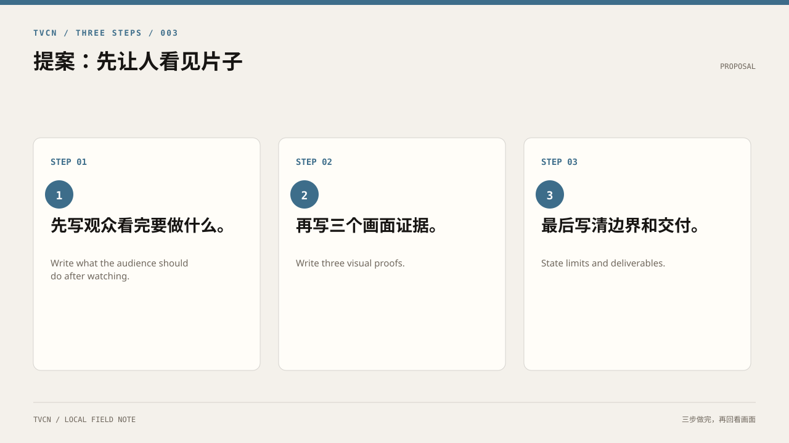

一页纸写清：观众跟谁走、遇到什么、最后看到什么变化。不要写镜头清单，也不要写导演阐述；这两样属于后面两步。

<!-- DIAGRAM_START -->
<h2>图解</h2>
<figure>
  
  <figcaption>看“提案用 12 页：一句话、三个参考画…”和“每页只讲一件事”两处，判断这个参数能不能对应到一个具体的拍摄问题。</figcaption>
</figure>
<!-- DIAGRAM_END -->
<section><h2 id="section-1">一页 treatment 只回答三个问题</h2>
用现在时写，每段一个动作。读完一页，客户能复述故事，才算通过。
<h2 id="section-2">边界</h2>
Treatment 不是文学创作。形容词越多，客户越不知道你要拍什么；把“温暖”“高级”换成可见的场景和动作。
</section><section><h2 id="section-3">现场</h2>
提案用 12 页：一句话、三个参考画面、拍摄方案、交付边界；每页只讲一件事，客户能看见片子。
</section><section><h2 id="section-4">怎么做</h2><ol><li>提案用 12 页：一句话、三个参考画面、拍摄方案、交付边界。</li><li>每页只讲一件事。</li><li>让客户在最后一页能说出片子长什么样、交什么、不包什么。</li></ol></section><section><h2 id="section-5">别踩</h2>
别用“高级感、电影感”当方案；客户看不见这两个词。
</section><section><h2>判断</h2>
现场只认三个信号：
<ul><li>每一项参数都能对应一个具体的拍摄问题</li><li>重量、供电和接口在真实机位上成立</li><li>60 秒测试能留下一个可比较的数字</li></ul></section><section><h2>失败</h2>
下面三种做法会让页面上的细节白做：
<ul><li>只看参数，不看接口、供电和重量</li><li>买回来才发现电池、存储或机身不匹配</li><li>没有 60 秒测试，问题被带到正式拍摄</li></ul></section><section><h2>延伸</h2>
<strong>10 分钟练习：</strong>用现有器材做 60 秒测试，只测“提案用 12 页：一句话、三个参考画…”；记下两个数字：一个是你需要的，一个是器材实际给出的。
</section>
<h2>验收</h2><ul><li>12 页里每页只有一个主题，没有堆满文字。</li><li>三个参考画面能说明片子的样子和语气。</li><li>客户能复述交付物、时间、价格和不包的范围。</li></ul>
