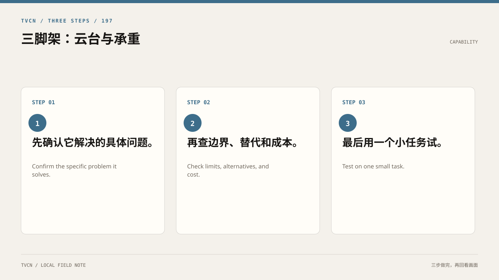

三脚架先看承重和云台，不看最大高度；相机加镜头加配件，往往比标称重。

<!-- DIAGRAM_START -->
<h2>图解</h2>
<figure>
  
  <figcaption>把三步按顺序做完，再回看画面或文件。</figcaption>
</figure>
<!-- DIAGRAM_END -->
<h2>现场</h2>

装上机身、镜头、监视器和电池，锁紧云台；轻推三下，看脚管和云台是否回弹。

<h2>怎么做</h2>

三脚架先看承重和云台，不看最大高度；相机加镜头加配件，往往比标称重。
<ol><li>装上机身、镜头、监视器和电池。</li><li>锁紧云台，轻推三下。</li><li>看脚管和云台是否回弹。</li></ol>
<h2>别踩</h2>

别按空机重量选脚架；装上镜头和电池，承重可能已经超了。

<h2>验收</h2>
<ul><li>称过完整配置重量，与脚架标称承重对照。</li><li>锁紧后轻推三下，脚管不滑、云台不回弹。</li><li>最高高度不是主要购买理由，稳定性优先。</li></ul>
