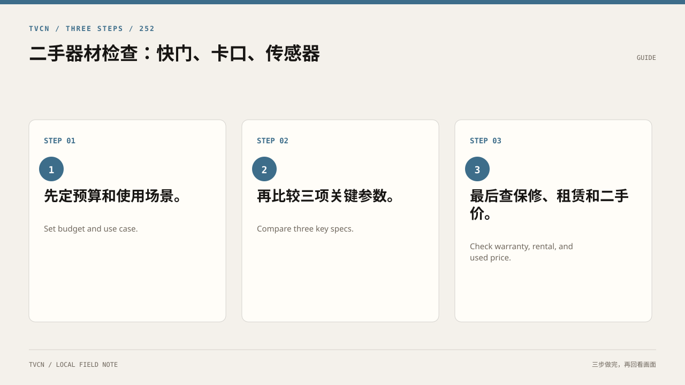

二手器材检查快门数、卡口松动、传感器坏点；三项都过再付钱。

<!-- DIAGRAM_START -->
<h2>图解</h2>
<figure>
  
  <figcaption>把三步按顺序做完，再回看画面或文件。</figcaption>
</figure>
<!-- DIAGRAM_END -->
<h2>现场</h2>

查快门数、卡口旷量、传感器坏点；拍白墙和天空各一张，回放看坏点。

<h2>怎么做</h2>

二手器材查快门、卡口、传感器；三项都过再付钱。
<ol><li>查快门数或使用时长，问清维修史。</li><li>装镜头晃卡口，看旷量和触点。</li><li>拍白墙和天空各一张，回放找坏点和暗角。</li></ol>
<h2>别踩</h2>

别只看外观成色；快门和传感器才是大头。

<h2>验收</h2>
<ul><li>快门数、使用时长和维修史问清了。</li><li>卡口旷量和触点检查过。</li><li>白墙和天空各拍一张，没有坏点或暗角。</li></ul>
