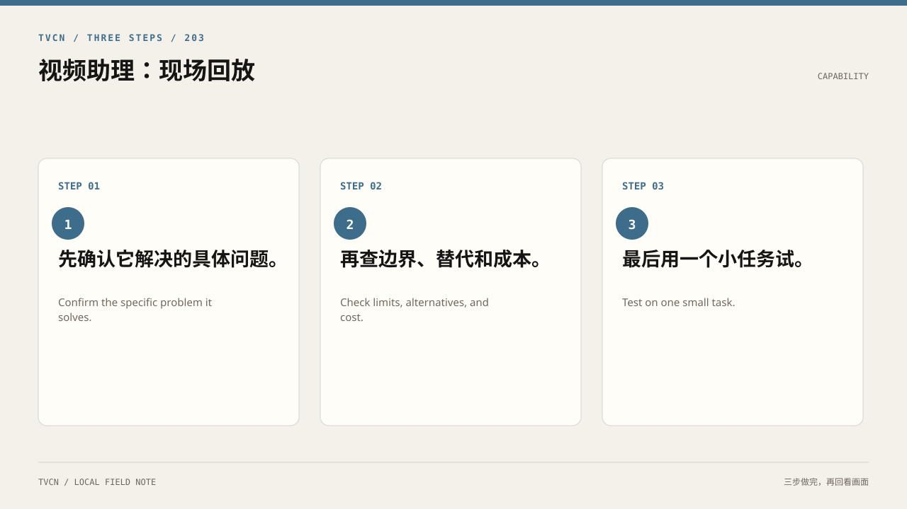

视频助理负责回放、标记和备份；导演能立刻看到刚才那条，拍摄速度会快很多.

<!-- DIAGRAM_START -->
<h2>图解</h2>
<figure>
  
  <figcaption>把三步按顺序做完，再回看画面或文件。</figcaption>
</figure>
<!-- DIAGRAM_END -->
<h2>现场</h2>

每拍一条，标记好、坏、场次、镜号；备份卡，导演回放时不用等。

<h2>怎么做</h2>

视频助理负责回放、标记和备份；导演能立刻看到刚才那条，拍摄速度会快很多。
<ol><li>每拍一条，标记好、坏、场次、镜号。</li><li>备份卡。</li><li>导演回放时不用等，直接调到对应条。</li></ol>
<h2>别踩</h2>

别只备份不标记；导演要回放时，全场陪你翻卡。

<h2>验收</h2>
<ul><li>每条素材有好坏、场次、镜号标记。</li><li>卡在拍摄间隙完成备份，有校验记录。</li><li>导演点一条，能在 30 秒内放到。</li></ul>
