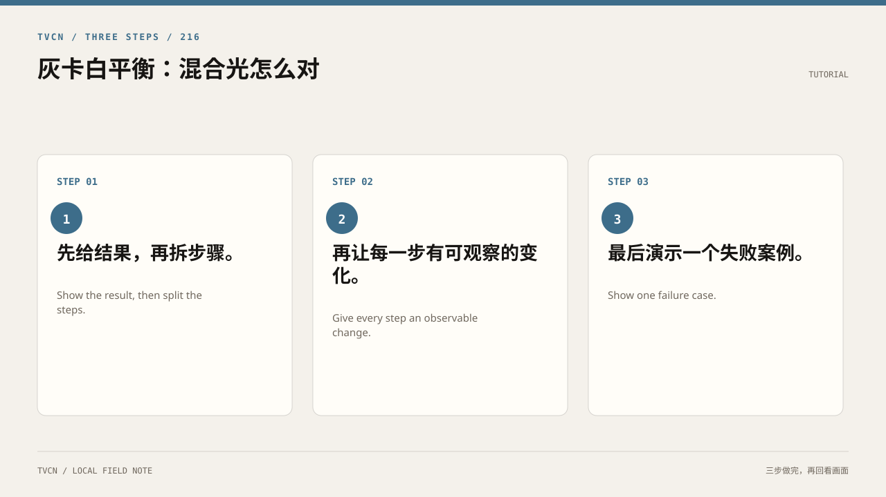

灰卡白平衡解决混合光下的中性；先把灰卡放到主体位置，再读。

<!-- DIAGRAM_START -->
<h2>图解</h2>
<figure>
  
  <figcaption>把三步按顺序做完，再回看画面或文件。</figcaption>
</figure>
<!-- DIAGRAM_END -->
<h2>现场</h2>

把灰卡放在主体位置，让光落在卡上；手动白平衡后拍一张，再看肤色。

<h2>怎么做</h2>

灰卡白平衡解决混合光下的中性；先把灰卡放到主体位置，再读。
<ol><li>把灰卡放在主体位置，让光落在卡上。</li><li>手动白平衡后拍一张。</li><li>再看肤色，确认没有偏色。</li></ol>
<h2>别踩</h2>

别在灯下对灰卡再拍窗边的人；位置不同，混合光也不同。

<h2>验收</h2>
<ul><li>灰卡放在主体位置，不是放在灯下。</li><li>手动白平衡后有样张，肤色可判断。</li><li>混合光下的偏色被消除或明确记录。</li></ul>
