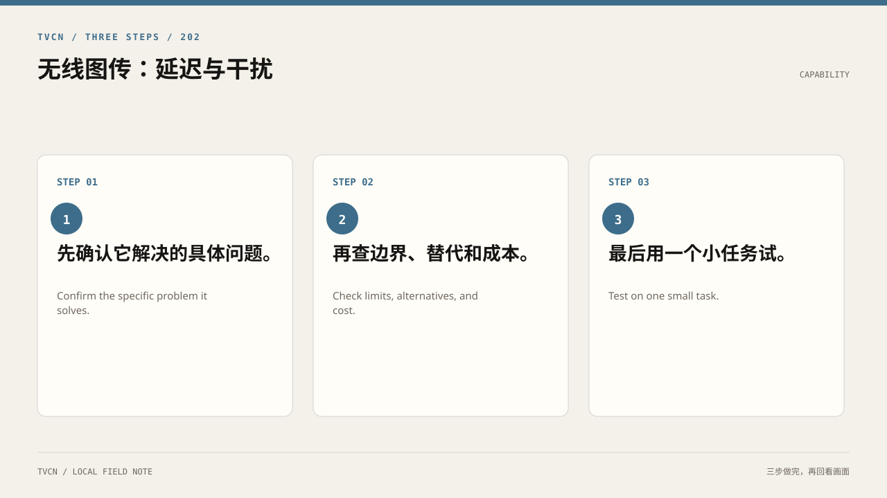

无线图传先测延迟和干扰，再决定给导演还是给跟焦；信号断了，现场就会停。

<!-- DIAGRAM_START -->
<h2>图解</h2>
<figure>
  
  <figcaption>把三步按顺序做完，再回看画面或文件。</figcaption>
</figure>
<!-- DIAGRAM_END -->
<h2>现场</h2>

在拍摄点走一圈，测延迟和断点；给导演的信号和跟焦的信号分开，别共用。

<h2>怎么做</h2>

无线图传先测延迟和干扰，再决定给导演还是给跟焦；信号断了，现场就会停。
<ol><li>在拍摄点走一圈，测延迟和断点。</li><li>给导演的信号和跟焦的信号分开。</li><li>断点位置记下来，加天线或换频段。</li></ol>
<h2>别踩</h2>

别让导演和跟焦共用一路图传；一断，两个人都停。

<h2>验收</h2>
<ul><li>走遍拍摄点，延迟和断点有记录。</li><li>导演监看和跟焦监看是两路独立信号。</li><li>断点位置有应对，比如加天线或换频段。</li></ul>
