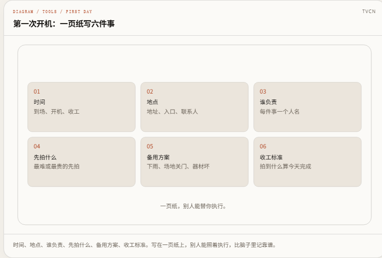

<!-- DIAGRAM_START -->
## 图解

<figure>
  
  <figcaption>时间、地点、谁负责、先拍什么、备用方案、收工标准。写在一页纸上，别人能照着执行，比脑子里记靠谱。</figcaption>
</figure>
<!-- DIAGRAM_END -->

## 一张只有一页的通告

通告不是发给别人看的，是逼自己把不确定的事写出来。集合时间、地址、联系人、午饭、停车、最晚收工，六行就够。地址写不出门牌号，说明你还没踩过点。

拍张照发到群里，让每个人回一个“到”。没有回复的人，默认他不会来；现场再打电话，通常已经来不及。

## 先拍光，再拍戏

外景的自然光不会等你。先拍窗边、逆光和黄昏，因为太阳每天都在走；能补拍的对话放在下午，不能补拍的天空放在早上。

镜头顺序按光和演员状态排，不按剧本页码排。新人常从第一场按顺序拍到结尾，结果最好看的黄昏只剩十分钟。

## 每个岗位只回答一个具体问题

摄影：这镜动不动？录音：有没有录到环境声？制片：午饭几点、车停哪里？导演只回答“要什么”，不要替所有人做决定。

收工前留十分钟：回放最后一条、备份一次、确认明天集合时间。少了这十分钟，第二天多半要补拍。

## 3 条验收

- 通告上的地址，司机能直接导航到。
- 最不可复制的光，在开机后两小时内拍完。
- 收工前，素材在另一块盘上能打开。

## 一页通告就够了

第一页只写：集合时间、地点、第一镜、最后一镜、联系人、天气备份。不要写二十页流程，现场没人看。

每个人拿到通告，应该能回答“我几点到、找谁、第一件事做什么”。

<!-- SOURCES_START -->
## 参考与延伸阅读

- [S23] [SMPTE：标准入口](https://www.smpte.org/standards) — 2026-11-26 访问。用于核对「一张只有一页的通告」一节的术语/方法/规则（SMPTE 标准入口，不是具体机型参数）；不核对其中由本页经验得出的数字、型号与现场结论，也不替代测试。
- [S31] [ARRI：电影系统](https://www.arri.com/en/cine-systems) — 2026-11-26 访问。用于核对「先拍光，再拍戏」一节的术语/方法/规则（ARRI 摄影机、镜头与灯光资料，不是通用拍摄教程）；不核对其中由本页经验得出的数字、型号与现场结论，也不替代测试。
<!-- SOURCES_END -->

