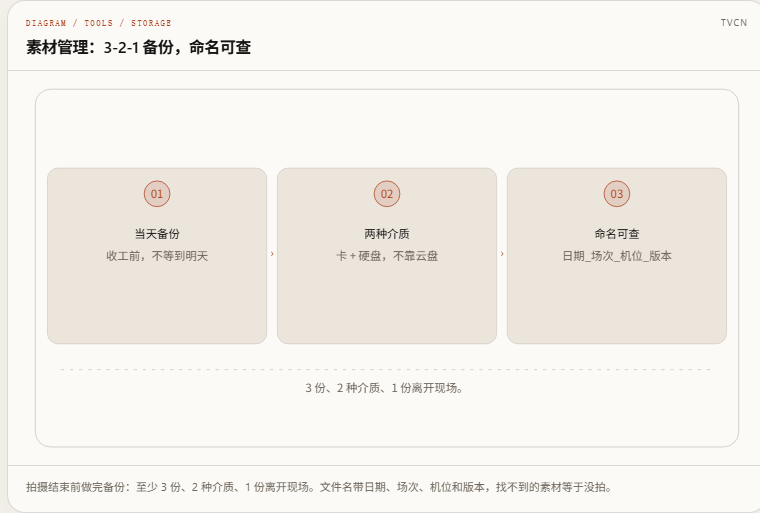

<!-- DIAGRAM_START -->
## 图解

<figure>
  
  <figcaption>拍摄结束前做完备份：至少 3 份、2 种介质、1 份离开现场。文件名带日期、场次、机位和版本，找不到的素材等于没拍。</figcaption>
</figure>
<!-- DIAGRAM_END -->

## 3-2-1 备份

至少三份：现场卡、移动硬盘、另一块盘或云。两份放在不同地方，一份离线。当天做完，不要等剪完再备份。

备份要校验，不是复制完就算。随机打开几个文件，确认能播、时长对、没有零字节。

## 命名规则

用“日期_片名_场次_机位_卡号”：20261120_coffee_S01_A_001。不要用 IMG_0001，也不要按“最终版”命名。

同一天同一场，用 S01、S02；同一场不同机位，用 A、B。名字里不要空格，跨系统更安全。

## 项目归档

归档不是把素材堆进一个文件夹。分成 footage、audio、graphics、project、export 五个目录，再放一份 README 说明版本。

AI 项目还要存提示词、种子、参考图和生成记录。否则三个月后无法复现，也无法证明素材来源。

## 3 条验收

- 当天有两份独立备份，并抽检可播放。
- 任意一镜能在一分钟内找到。
- AI 项目存了提示词、种子和参考图。

<!-- DEEP_DIVE_START -->
## 深读

<strong>约 7 分钟。</strong> 存储不是买一块大硬盘，是让同一份素材在三个地方，且你知道哪一份是最新。

### 三份备份

现场卡一份、移动硬盘一份、另一块硬盘或云端一份；三份不要放在同一个包里。拍完当天备份，不要等剪辑开始。

备份完做校验：随机打开三个文件播放，核对文件大小和数量；不要只看进度条到 100%。

### 项目文件夹要能看懂

按项目、日期、相机、场次分；文件名带日期和版本，不要用“最终版”“最终版2”。素材、代理、输出、音频、图形分开放。

写一张 README：哪个文件夹是原始素材、哪个是代理、哪个是最终输出；三个月后你还能找到。

### 容量要算，不要猜

按码率算：每分钟大小等于码率乘六十除以八；再乘拍摄分钟数、相机数、备份份数。算完留百分之二十余量。

卡的速度也要算：持续写入不够，会掉帧；不要只看标称峰值。买卡前查你相机的推荐卡型。

### 五分钟练习：一个项目存储表

写一个三天项目：每天几分钟、几台机、什么码率、几份备份；算出总容量和需要几块硬盘。

把表给后期看，问他“够不够”；他说不够，就加一份，不要等素材满了再买。

### 什么时候算安全

三份备份都在、校验播放过、目录有人能看懂、容量余量超过百分之二十、旧项目已归档；五项都过，才算安全。

只有两份，不叫备份，叫“还没丢”；把第三份补上，再开始剪。

### 再看一遍第三份

拔掉两块硬盘，只用第三份打开项目：能不能找到原始素材、能不能播放、能不能重建目录；第三份不是“以后会用”，是现在就能单独救活项目的那一份。

### 存储，十项检查
<ul><li>现场卡一份</li><li>移动硬盘一份</li><li>第三份异地或云端</li><li>三份不放同一个包</li><li>拍完当天备份</li><li>随机播放三个文件校验</li><li>文件名带日期版本</li><li>素材代理输出分开</li><li>按码率算容量留两成</li><li>持续写入速度够</li></ul>
存储的安全感不来自硬盘多大，来自你能说出三份分别在哪。

<!-- DEEP_DIVE_END -->

<!-- SOURCES_START -->
## 参考与延伸阅读

- [S29] [YouTube 上传规格](https://support.google.com/youtube/answer/1722171) — 2026-11-26 访问。用于核对首段“拍摄结束前做完备份，文件名带日期、场次、机位。找不到的素材等于没拍。”中的术语与公开背景（分辨率、码率、帧率与音频编码建议）；不替代现场测试。
- [S70] [FFmpeg：文档](https://ffmpeg.org/documentation.html) — 2026-11-26 访问。用于核对首段“拍摄结束前做完备份，文件名带日期、场次、机位。找不到的素材等于没拍。”中的术语与公开背景（编解码、封装与滤镜文档）；不替代现场测试。
<!-- SOURCES_END -->

