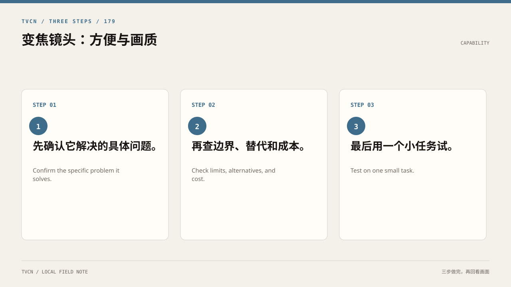

变焦镜头省时间，但要在重量、光圈和画质之间付账；先问今天最缺哪一样。

<!-- DIAGRAM_START -->
<h2>图解</h2>
<figure>
  
  <figcaption>把三步按顺序做完，再回看画面或文件。</figcaption>
</figure>
<!-- DIAGRAM_END -->
<h2>现场</h2>

带机器去店里，全开光圈拍逆光窗和栏杆；看边缘、畸变和呼吸，再称重量。

<h2>怎么做</h2>

变焦镜头省时间，但要在重量、光圈和画质之间付账；先问今天最缺哪一样。
<ol><li>带机器去店里，全开光圈拍逆光窗和栏杆。</li><li>看边缘、畸变和呼吸。</li><li>再称重量，决定是否为方便付这个价。</li></ol>
<h2>别踩</h2>

别只看中心锐度；边缘和逆光才是变焦最容易露馅的地方。

<h2>验收</h2>
<ul><li>全开光圈拍了逆光窗和栏杆，边缘表现有记录。</li><li>畸变和呼吸能被指出，不是只说“画质好”。</li><li>重量称过，并说清它替你省了哪一步。</li></ul>
